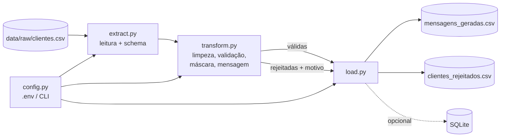

# 🛡️ Customer Messaging ETL Pipeline


[](https://github.com/SimoesBia/etl-projeto/actions)


Pipeline ETL em Python que **valida dados de clientes, mascara informações sensíveis e gera mensagens personalizadas**, separando o que é válido do que precisa de revisão.

## 🎯 Problema e solução

Equipes de CRM e marketing recebem planilhas de clientes com dados sujos (nomes vazios, contas malformadas, cartões incompletos, duplicidades) e, muitas vezes, com **números de cartão completos** circulando em arquivos de saída.

Este projeto resolve isso em um fluxo reproduzível:

- **Extrai** o CSV garantindo o schema esperado e preservando zeros à esquerda (`00789` continua `00789`).
- **Transforma**: normaliza nomes, valida conta e cartão, remove duplicidades e **mascara o cartão** (`**** **** **** 4444`), conforme boas práticas de proteção de dados (LGPD).
- **Carrega** o resultado em CSV (escrita atômica) e, opcionalmente, em SQLite. Linhas inválidas vão para um arquivo próprio, com o **motivo da rejeição**.

## 🏗️ Arquitetura



```
etl-projeto/
├── src/etl_pipeline/
│   ├── cli.py            # interface de linha de comando (argparse)
│   ├── config.py         # settings via .env / variáveis de ambiente
│   ├── extract.py        # E: leitura e validação de schema
│   ├── transform.py      # T: limpeza, regras de qualidade, máscara, mensagens
│   ├── load.py           # L: CSV atômico e SQLite
│   ├── pipeline.py       # orquestração + métricas de execução
│   ├── exceptions.py     # hierarquia de erros de domínio
│   └── logging_config.py
├── tests/                # pytest: unitários + ponta a ponta
├── data/raw/             # dados fictícios de exemplo
├── .github/workflows/    # CI (lint + testes, Python 3.11 e 3.12)
├── Dockerfile · Makefile · pyproject.toml · requirements*.txt · .env.example
```

## ✨ Funcionalidades

| Funcionalidade | Descrição |
|---|---|
| Validação de schema | Falha cedo com `SchemaValidationError` se faltarem colunas (`nome`, `conta`, `cartao`) |
| Regras de qualidade | `nome_vazio`, `conta_invalida` (4–12 dígitos), `cartao_invalido` (13–19 dígitos), `conta_duplicada` |
| Mascaramento | Só os 4 últimos dígitos do cartão chegam à saída; o cartão completo nunca é gravado |
| Quarentena de erros | `clientes_rejeitados.csv` com número da linha de origem e motivo(s) |
| Mensagens configuráveis | Template via `.env` com `{nome}` e `{primeiro_nome}`, validado antes da execução |
| Saída dupla | CSV (escrita atômica) e SQLite opcional |
| Observabilidade | Logs estruturados e métricas (lidas / válidas / rejeitadas / tempo) |
| Códigos de saída | `0` sucesso · `1` erro esperado (arquivo, schema, I/O) · `2` erro inesperado |

### Opções da CLI

| Flag | Descrição |
|---|---|
| `--input` | CSV de entrada |
| `--output` | CSV com as mensagens geradas |
| `--rejected` | CSV com as linhas rejeitadas |
| `--sqlite` | Também grava a tabela `mensagens` neste banco SQLite |
| `--log-level` | `DEBUG`, `INFO`, `WARNING` ou `ERROR` |

## 🚀 Como executar

**Pré-requisito:** Python 3.11+

```bash
# 1. Clonar
git clone https://github.com/SimoesBia/etl-projeto.git
cd etl-projeto

# 2. Ambiente virtual
python -m venv .venv
source .venv/bin/activate        # Windows: .venv\Scripts\activate

# 3. Dependências
pip install -r requirements-dev.txt
pip install -e .

# 4. Configuração (opcional, há valores padrão)
cp .env.example .env

# 5. Executar
python -m etl_pipeline
# ou, com opções:
python -m etl_pipeline --sqlite data/processed/clientes.sqlite --log-level DEBUG
```

### Exemplo de saída

Entrada (`data/raw/clientes.csv`, dados fictícios) → `data/processed/mensagens_geradas.csv`:

```csv
nome,conta,cartao_mascarado,mensagem
Ana Silva,12345,**** **** **** 4444,"Olá Ana, temos novidades exclusivas para você!"
Bruno Costa,67890,**** **** **** 8888,"Olá Bruno, temos novidades exclusivas para você!"
Carla Souza,54321,**** **** **** 2222,"Olá Carla, temos novidades exclusivas para você!"
Diego Lima,00789,**** **** **** 9010,"Olá Diego, temos novidades exclusivas para você!"
```

E `data/processed/clientes_rejeitados.csv`:

```csv
linha,nome,conta,motivo
6,,11111,nome_vazio
7,Eva Martins,ABC,conta_invalida
8,Fabio Rocha,22222,cartao_invalido
9,Ana Silva Duplicada,12345,conta_duplicada
```

### Testes, lint e Docker

```bash
make test          # pytest + cobertura
make lint          # ruff check + format --check
make docker-build  # constrói a imagem
make docker-run    # executa montando ./data como volume
```

## 🔧 Decisões de engenharia

- **Leitura como texto (`dtype=str`)**: evita que `00789` vire `789`, um bug clássico em pipelines com CSV.
- **Privacidade por padrão**: a versão original gravava o número completo do cartão no arquivo de saída; agora só a máscara é persistida, e o arquivo de rejeitados não contém dados de cartão.
- **Escrita atômica**: arquivo temporário + `rename`, sem risco de saída truncada em caso de falha.
- **Execução idempotente**: rodar duas vezes gera exatamente o mesmo resultado (coberto por teste).
- **Erros de domínio** (`ExtractError`, `LoadError`, `ConfigError`) separados de bugs, com códigos de saída distintos para facilitar integração com schedulers.
- **Caminhos relativos à raiz do projeto**, não ao diretório atual, então o resultado não depende de onde o comando é executado.

## 🔮 Melhorias futuras

- [ ] Processamento em *chunks* (`chunksize`) e saída em **Parquet** para volumes grandes
- [ ] Validação de cartão com **algoritmo de Luhn** e detecção de bandeira
- [ ] Contratos de dados com **Pydantic** ou **Pandera**
- [ ] Orquestração com **Airflow** ou **Prefect** (agendamento, retries, alertas)
- [ ] Exposição como **API REST com FastAPI** (`POST /messages`, `GET /runs/{id}`)
- [ ] Geração das mensagens com **LLM** (personalização por perfil) com cache e fallback para o template
- [ ] Carga em **PostgreSQL** e *data quality report* publicado a cada execução
- [ ] Checagem de tipos com **mypy** e relatório de cobertura no CI

## 👩‍💻 Autora

**Bruna Beatriz Maria Souza Simões**: [GitHub](https://github.com/SimoesBia)

## 📄 Licença

Distribuído sob a licença MIT. Veja [LICENSE](LICENSE).
